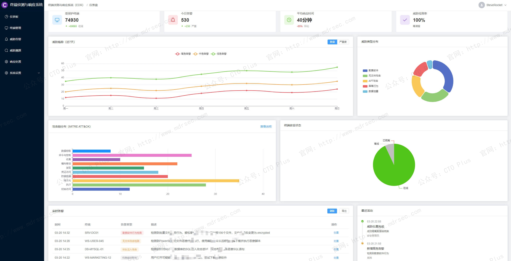
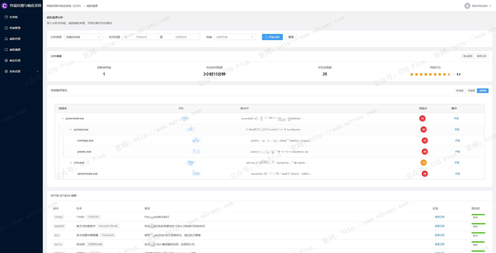
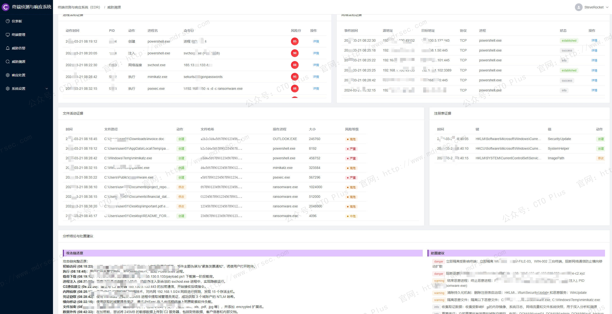
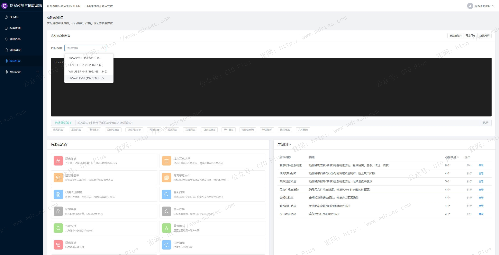
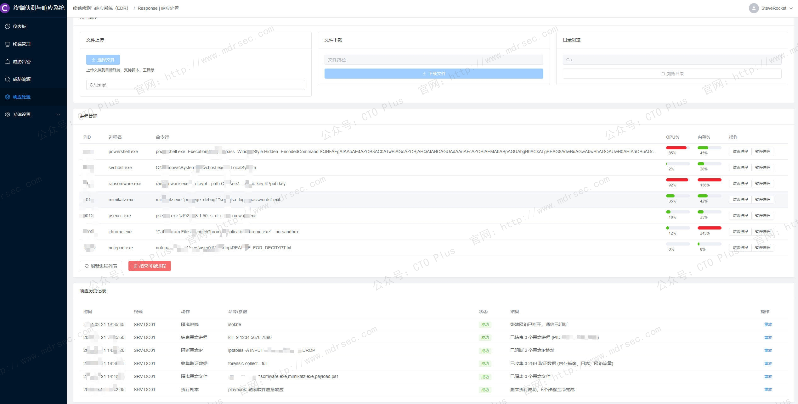
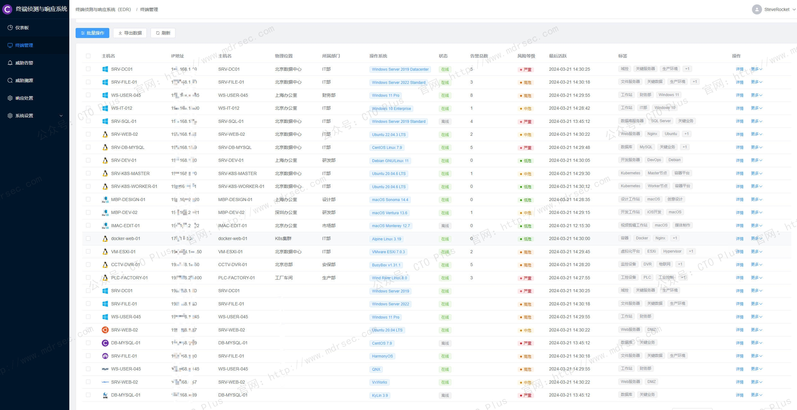

# 终端侦测与响应系统（EDR）

## 关于我们

- 官网： http://www.mdrsec.com

我们的技术文章和产品概述欢迎浏览我们的门户。

- 公众号：CTO Plus

最新的动态欢迎关注我们官方唯一公众号。

- 作者QQ

更详细更具体的需求，或者项目合作，或者问题 欢迎联系我。

- QQ群

我们官方组建的QQ群，如果您有兴趣也可以加入我们。

- 请喝咖啡

如果感兴趣，也可以请我喝杯咖啡

## 产品核心功能模块

终端侦测与响应系统（EDR）是企业从“被动防御”转向“主动治理”的关键安全基础设施。这里我将为大家分享下我们自研的终端侦测与响应系统（EDR），下面简称EDR

接下来从架构、核心功能、检测能力、响应机制、运营协同到评估维度，介绍下我们EDR的功能特性。

## 功能模块

- 仪表板：全局安全态势展示，包含统计卡片、威胁趋势、实时告警等
- 终端管理：终端设备管理，支持搜索、过滤、批量操作
- 威胁告警：告警事件管理，支持分类、筛选、处置
- 威胁溯源：攻击链分析，进程树可视化
- 响应处置：实时响应操作，支持隔离、扫描等动作
- 实时仪表板、全局安全态势展示、威胁趋势分析、实时告警监控、MITRE ATT&CK映射、终端管理、终端设备监控、风险等级评估、批量操作支持、实时状态更新、威胁告警、多维度告警过滤、告警级别分类、自动化处置流程、攻击链分析、威胁溯源、进程树可视化、网络连接追踪、文件活动监控、MITRE ATT&CK映射、响应处置、实时终端连接、远程命令执行、自动化剧本、文件操作管理

端威胁检测与溯源分析

- 功能：
    - 数据采集：监控进程、IP访问、文件操作、注册表变更等。
    - 智能检测：基于行为引擎和AI模型检测异常（如Powershell滥用）。
    - 攻击链溯源：可视化展示进程树和攻击链路。

威胁响应与自动化处置

- 功能：
    - 实时响应（RTR）：远程执行命令、隔离终端。
    - SOAR集成：自动化剧本（如Falcon Fusion）。

后端结合Spring Cloud、大数据分析平台（如Elasticsearch）及AI检测引擎（如机器学习模型）构建。系统可满足大型企业（十万级终端）的安全运营需求。

## 功能特性

我们的终端侦测与响应系统（EDR）与传统的杀毒软件仅关注文件特征不同，EDR依赖于部署在终端的轻量级代理（Agent），构建终端活动的全维画像 。

- 全量行为数据采集：系统需在内核态与用户态进行高频数据采集，不仅记录文件创建/删除，更需深入监控进程树、网络连接（源/目IP及协议）、注册表变更、内存调用、用户登录及权限变更等 。这是区别于传统EPP仅做静态扫描的核心差异。
- 多维关联与上下文构建：EDR必须具备大数据处理能力，将孤立的日志（如一条进程启动记录和一个网络请求）通过时间戳和因果关系串联成完整的“事件链”，为后续的威胁狩猎提供上下文 。

### 高级威胁检测引擎

- 基于行为的动态分析 ：EDR不依赖单一特征码，而是通过建立业务正常运行的基线，利用无监督学习算法识别“偏离”。例如，监控`vssadmin`删除卷影副本、高频加密IO操作（勒索特征）或PowerShell异常调用（无文件攻击特征） 。
- ATT&CK技战术映射：优秀的EDR能将检测到的可疑行为自动映射到MITRE ATT&CK框架，帮助分析师理解攻击者所处的阶段（如初始访问、权限提升、横向移动），从而研判威胁等级 。
- 威胁情报与IOC/IOA融合：系统需内置高质量的商业级或开源威胁情报，不仅匹配已知的失陷指标（IOC），更侧重于匹配攻击行为模式（IOA），以对抗0day漏洞和变种恶意软件 。

### 主动防御与自动化响应编排

- 多级响应策略：支持丰富的处置动作，包括但不限于：进程终止、文件隔离/删除、注册表回滚、网络隔离（主机防火墙联动）以及禁用特定账号等 。
- 自动化编排剧本 ：针对高频场景（如钓鱼邮件、勒索病毒爆发），系统应支持预设响应剧本。例如，检测到勒索软件行为时，无需人工干预即可自动阻断进程并断网，将MTTR（平均响应时间）从小时级压缩至毫秒级 。
- 攻击可视化与根因溯源：EDR必须提供直观的攻击链路图，以进程树的形式还原恶意程序的孵化关系、文件操作和网络行为。这帮助安全团队清晰回答“攻击者从哪来、做了什么、走了哪条路”，大幅降低取证分析门槛 。

### 主动狩猎与深度调查能力

我们EDR不仅是报警器，更是安全分析师进行主动猎捕的数据平台。

- 灵活的查询语言：提供强大的交互式搜索能力，允许分析师根据特定的IOC或假设的攻击行为（如“搜索过去24小时内所有调用`cmd.exe`且父进程为`winword.exe`的事件”）在全网终端中进行回溯性检索 。
- 海量数据长期存储：不同于日志系统的高频滚动，EDR需支持对关键行为数据的长期存储，以便在发现新型漏洞或情报时，回溯核查历史数据中是否存在早已潜伏的威胁 。

### 性能与稳定性

- 资源占用可控性：终端Agent需经过深度优化，在保证采集颗粒度的前提下，确保CPU峰值占用率不超过特定阈值（通常<5%），内存占用需精打细算，避免在高并发IO场景下引发业务卡顿 。
- 灵活的部署与适配：支持混合架构（物理机、虚拟机、容器），全面兼容主流OS及信创国产化系统（麒麟、统信等），并提供离网环境下的本地更新与管控能力 。

### 开放集成与生态扩展性

孤立的安全工具是运维的负担，我们EDR系统必须是安全生态中的关键一环。

- 北向接口与联动：需提供标准的Syslog或Restful API接口，与SIEM（安全信息与事件管理）、SOAR（安全编排与自动化响应）及态势感知平台无缝对接，实现安全数据的集中分析与跨设备联动封堵 。
- XDR演进能力：具备向XDR演进的潜力，即不仅能处理终端数据，还能接入网络流量、邮件网关、云工作负载等第三方数据源，打破数据孤岛进行综合性威胁分析 。

我们自研的SIEM系统、SOAR系统、XDR系统在前面的文章中都各自有介绍。

### 评估与验证维度

同时，我们EDR还支持以下核心指标 ：

- 检测覆盖率：对无文件攻击、APT渗透、横向移动的盲区覆盖率。
- 信噪比与误报率：是否能结合上下文分析有效抑制孤立告警，避免告警疲劳。
- 策略自进化能力：系统能否基于本地化的流量特征和红蓝对抗结果，持续优化检测模型。

## 最后

我们的EDR系统，可以看上去是 **“终端大数据的智能分析平台”** 。不再满足于对已知恶意代码的查杀，而是通过持续的监控、智能的行为分析和自动化的响应闭环，为企业构建应对未知威胁的免疫系统。

## 产品清单

### 企业网络安全运营中心产品

- 资产安全配置管理系统（SCMDB）
- 终端侦测与响应系统（EDR）
- 网络侦测与响应系统（NDR）
- 企业网络资产攻击面管理系统（CAASM）
- 资产暴露面管理系统（AEMS）
- 网络安全蜜罐管理系统（HoneyPot）
- 安全事件收集与告警管理系统（SIEM）
- 扩展侦测与响应系统（XDR）
- 多引擎脆弱性扫描系统（VAS）
- 多源日志审计监测系统（LAS）
- 网络安全威胁情报中心（TIS）
- 网络安全漏洞库管理系统（VDBS）
- 网络安全编排与自动化响应（SOAR）
- 威胁狩猎系统（THS）
- 数据库安全审计系统（DSAS）
- AI智能体安全态势管理系统（AISPM）
- Web防火墙（WAF）
- 网站安全监测平台（WSM）
- 网络安全态势感知平台（SSAP）
- 网络安全自动化应急响应工具系统（NSRT）
- 企业网络安全运维工具系统（SecTools）
- 网络安全自动化等保测评系统（ASES）
- 浏览器安全监测防护系统（BSMPS）
- 网络安全用户实体行为分析系统（UEBA）
- 互联网电信诈骗预警防护系统（TPFWS）
- 云原生安全管理平台（CNAPP）
- 自动化渗透测试系统（PTS）
- 工业企业信息安全监测中心（IoT SOC）
- 企业智能安全运营中心（AISOC）

### 企业自动化运维产品

- 运维智能监控告警管理平台（AIMAMS）
- 企业网络工具系统（NTools）
- 自动化测试系统（AutoTest）
- 自动化运维系统（AutoOps）
- 企业运维工具系统（OpsTools）
- 物联网管理系统（IoTS）
- 软件开发生命周期管理系统（SDLC）
- IT流程管理系统（ITSM）

### 企业数字化运营资源管理系统产品

- 制造执行管理系统（MES）
- 运输管理系统（TMS）
- 跨境电商企业资源管理系统（ERP）
- 企业客户关系管理系统（CRM）
- 跨境电商仓库管理系统（WMS）
- 财务管理系统（FMS）
- 质量管理系统（QMS）
- 精准营销管理系统（PMS）
- 智能生产管理系统（SPMS）
- 电商BI系统（BI）
- 智能互联网分布式爬虫系统（AISpider）

## ABOUT

**【关于我们】**

* [主页：http://116.205.137.183/index_pro.html](http://116.205.137.183/index_pro.html)
* [Articulate v1.0](https://mp.weixin.qq.com/s/0yqGBPbOI6QxHqK17WxU8Q)
* [Articulate v2.0](https://mp.weixin.qq.com/s/V5Axn-ZWi22ubh5Jiocb9g)

 🥰

**【代码工程系列】**

* [Python和Go的设计模式](https://github.com/zrf-rocket/DesignPattern)
    * GitHub：https://github.com/zrf-rocket/DesignPattern
    * Gitee：https://gitee.com/SteveRocket/design_pattern

* [Python、Go的编码技巧cookbook](https://github.com/zrf-rocket/CookBook)
    * GitHub：https://github.com/zrf-rocket/CookBook
    * Gitee：https://gitee.com/SteveRocket/cook-book

* [Go代码示例](https://github.com/zrf-rocket/PracticeGo)
    * GitHub：https://github.com/zrf-rocket/PracticeGo
    * Gitee：https://gitee.com/SteveRocket/practice_go

* [Python代码示例](https://github.com/zrf-rocket/PracticePython)
    * GitHub：https://github.com/zrf-rocket/PracticePython
    * Gitee：https://gitee.com/SteveRocket/practice_python

* [Python Web框架的示例代码](https://github.com/zrf-rocket/PythonFramework)
    * GitHub：https://github.com/zrf-rocket/PythonFramework
    * Gitee：https://gitee.com/SteveRocket/python_framework

* [Rust代码示例](https://github.com/zrf-rocket/PracticeRust)
    * GitHub：https://github.com/zrf-rocket/PracticeRust
    * Gitee：https://gitee.com/SteveRocket/practice_rust

* [Vue代码示例](https://github.com/zrf-rocket/PracticeVue)
    * GitHub：https://github.com/zrf-rocket/PracticeVue
    * Gitee：https://gitee.com/SteveRocket/practice_vue

* [前端代码示例](https://github.com/zrf-rocket/PracticeFronted)
    * GitHub：https://github.com/zrf-rocket/PracticeFronted
    * Gitee：https://gitee.com/SteveRocket/practice_fronted

* [Python自动化测试框架](https://github.com/zrf-rocket/PythonTestAutomationFramework)
    * GitHub：https://github.com/zrf-rocket/PythonTestAutomationFramework
    * Gitee：https://gitee.com/SteveRocket/python_test_automation_framework

* [Python和Go的算法代码示例](https://github.com/zrf-rocket/Algorithms)
    * GitHub：https://github.com/zrf-rocket/Algorithms
    * Gitee：https://gitee.com/SteveRocket/Algorithms

* [Python和Go的数据结构代码示例](https://github.com/zrf-rocket/DataStructure)
    * GitHub：https://github.com/zrf-rocket/DataStructure
    * Gitee：https://gitee.com/SteveRocket/data_structure

* [编码规范](https://github.com/zrf-rocket/DevGuide)
    * GitHub：https://github.com/zrf-rocket/DevGuide
    * Gitee：https://gitee.com/SteveRocket/develop_guide

* [编码安全规范](https://github.com/zrf-rocket/SecGuide)
    * GitHub：https://github.com/zrf-rocket/SecGuide
    * Gitee：https://gitee.com/SteveRocket/security_guide

**【产品系列】**

* [主机监控系统-日志收集与报警管理系统（SIEM）](https://github.com/zrf-rocket/SIEM)
    * GitHub：https://github.com/zrf-rocket/SIEM
    * Gitee：https://gitee.com/SteveRocket/siem

* [安全运营中心（SOC）-终端侦测与响应系统（EDR）](https://github.com/zrf-rocket/EDR_SOC)
    * GitHub：https://github.com/zrf-rocket/EDR_SOC
    * Gitee：https://gitee.com/SteveRocket/edr_soc

* [DevSecOps-SDLC](https://github.com/zrf-rocket/DevSecOps-SDLC)
    * GitHub：https://github.com/zrf-rocket/DevSecOps-SDLC
    * Gitee：https://gitee.com/SteveRocket/dev-sec-ops-sdlc

* [AI图像识别-智能缺陷检测系统]()
    * [基于AI图像识别的工业缺陷检测应用系统（GPU&FPGA）](https://mp.weixin.qq.com/s/04qefQFg-Pg1Gcqq1vBLQQ)
    * [基于AI图像识别的智能缺陷检测系统，在钢铁行业的应用-技术方案](https://mp.weixin.qq.com/s/dSHbnuOwQZzE4CvPr1JYjg)

# 安全运营中心（SOC）-终端侦测与响应系统（EDR） 

